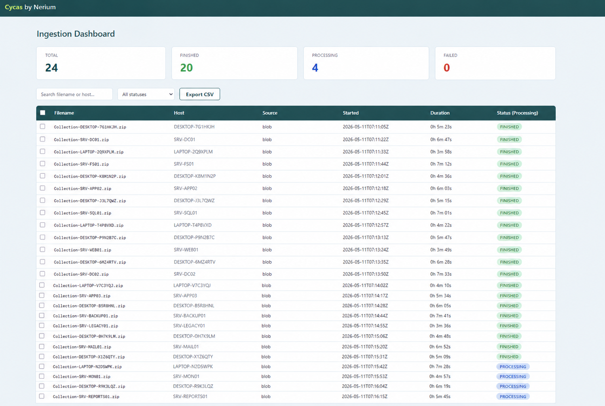

# Cycas

Cycas is a Digital Forensics & Incident Response (DFIR) platform that turns the
forensic data you collect with [Velociraptor](https://github.com/Velocidex/velociraptor)
into a queryable [Azure Data Explorer (ADX)](https://azure.microsoft.com/nl-nl/products/data-explorer)
database. It is built by the incident responders at Nerium, for incident responders.

A single command spins up the entire platform in Azure in about 15 minutes. 
The work of provisioning a cloud forensic platform is done for you, including 
ready-to-deploy Velociraptor client installers for Windows, Linux and macOS. 
Every engagement starts on a fresh environment of its own.

## Combining Mass data collection with live response

At Nerium we believe in preserving evidence at the start of an engagement, not
when the investigation happens to need it. Cycas is built around a mass
collection of triage packages from every endpoint in scope, as early as
possible:

- **Evidence is volatile.** Artifacts are overwritten all the time. Capture them
  too late and the context you need for the attacker timeline may be gone.
- **You can always go back to the original evidence.** The raw files are kept,
  so you can re-parse them with a new tool, answer a question nobody asked on
  day one, or back up a finding with the source data.
- **Recovery does not have to wait.** Once a host is collected, it can be
  reimaged or restored while the investigation continues on the preserved data.

And if you missed something during the mass collection (say IIS logs) the
Velociraptor server lets you collect it yourself, without asking the
client to run another collection and waiting on the results. 

The same goes for dealing with a live attacker: you can hunt across connected 
endpoints in real time as the situation develops. Everything you gather this 
way flows into the same ADX database as the mass collection.

## Compute that scales with the incident

An incident can mean five endpoints or five thousand. Cycas is designed so the
compute follows the size of the case:

- **Ingestion scales out horizontally.** The processing runs on Azure Functions
  (Flex Consumption), which fan out across many instances under load - Cycas
  comfortably processes 500+ triage packages concurrently - and scale back to
  nothing when the queue is empty.
- **Analytics are sized per engagement.** The ADX cluster is chosen to match the
  case: a small cluster for a handful of hosts, a larger one for an estate-wide
  response.
- **Pay-per-use, disposable.** No up-front SIEM licence. A whole engagement can
  live in a single resource group and be deleted when it is closed - you pay for
  what the incident actually needed.

## One command, a full forensic platform

`python easy_install.py` provisions and connects everything Cycas needs. Behind
the scenes it sets up:

- An **ADX cluster and database**, sized to the engagement.
- A **storage account** - the blob input container, a processing queue, and a
  status table.
- **Two Azure Functions** (a watcher and a processor) on a plan that scales out
  horizontally, with Application Insights for monitoring.
- A **Key Vault** for the collection ZIP password and service
  credentials.
- A **Velociraptor server** on a VM with a static IP, with
  **prebuilt client installers** (standard and obfuscated Windows MSIs, Linux
  deb/rpm, macOS) and a set of **prepared hunts** ready to launch.
- A **status dashboard**.
- **Offline Velociraptor collectors** for Windows, Linux and macOS, uploaded to
  the input container.

Connection strings, role assignments, managed identities and secrets are all
configured automatically, and progress is saved so an interrupted run can
resume.

## Features

- Ingests triage packages from Azure Blob Storage, SFTP, or a local folder.
- Processes 500+ triage packages concurrently using Azure Functions.
- Post-processes raw Velociraptor artifacts (MFT, EVTX, and more) before
  ingesting them into ADX.
- Automatic ADX schema inference - no hand-maintained table definitions, schemas
  extend themselves as new fields appear.
- Tags every record with the hostname it came from.
- Pay-per-use Azure resources: no expensive SIEM licence, and a whole engagement
  can live in a disposable resource group.

## Dashboard

Cycas includes a dashboard so you can track ingestion status at a
glance.

## Getting started

We've made it easy to get started. Find the instructions in our documentation to
run `easy_install.py`: [Getting Started](https://cycas.readthedocs.io/en/latest/gettingstarted/installation.html)

## License

See LICENSE for details.
